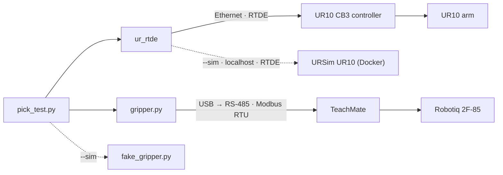

# auto-UR10

Integrating an autonomous software system for a **Universal Robots UR10** collaborative arm.

This project brings a second-hand UR10 cell back into service and controls it from Python: the arm over Ethernet with RTDE, and a Robotiq 2F-85 gripper over RS-485 (Modbus RTU), both coordinated from a single script.

## Hardware

| Component | Details |
|---|---|
| Robot arm | Universal Robots UR10, CB3 controller, PolyScope 3.15.6 |
| Base | Ready Robotics TaskMate R10 mobile cart |
| Gripper | Robotiq 2F-85 (2-finger, electric) |
| Gripper interface | USB-to-RS-485 adapter, through the Ready Robotics TeachMate |
| Camera | Intel RealSense D455 |

## How it works



- The **UR10 controller** keeps real-time control and enforces the safety limits (safety planes and joint position limits).
- **`safety.py`** holds a copy of those limits. The motion scripts check every planned path against it, with a margin, before moving; see [Safety configuration](docs/setup.md#safety-configuration).
- **`ur_rtde`** sends motion commands and reads the robot state.
- **`gripper.py`** drives the gripper directly with Modbus RTU frames, without a URCap.
- The cart's original Ready Robotics ForgeOS layer is not used; the robot runs on native PolyScope.
- **URSim**, Universal Robots' simulator, runs as a simulated UR10 in Docker on the control computer, with the robot's installation loaded, so `ur_rtde` scripts can be tried on `127.0.0.1` before the real arm. With `--sim`, **`robot.py`** points the scripts at it and swaps in **`fake_gripper.py`** for the gripper; see [Simulation (URSim)](docs/setup.md#simulation-ursim).

## Repository

| Path | Description |
|---|---|
| `README.md` | Project overview, hardware, architecture and quick usage. |
| `requirements.txt` | Python dependencies: `ur_rtde`, `pyserial`, and `pytest` for the offline tests. |
| `.gitignore` | Ignores Python artifacts, editor/OS files, robot backups, PolyScope programs, installations and variables files, and logs. |
| `LICENSE` | MIT License. |
| `CLAUDE.md` | Guidance for Claude Code: project context, git rules, documentation and hardware-safety requirements. |
| [`scripts/`](scripts/) | Python control scripts. |
| [`scripts/gripper.py`](scripts/gripper.py) | Minimal Modbus RTU driver for the Robotiq 2F-85: status, activate, open, close. Usable from the command line or as a module. |
| [`scripts/pick_test.py`](scripts/pick_test.py) | Arm and gripper smoke test: activates the gripper, lifts the tool 2 cm, closes and opens the gripper, returns to the start pose. |
| [`scripts/show_pose.py`](scripts/show_pose.py) | Read-only position readout: prints the TCP pose (mm, rotation vector, roll/pitch/yaw) and joint angles, once or continuously with `--watch`. |
| [`scripts/pick_place.py`](scripts/pick_place.py) | Moves from the current position to a fixed target pose, closes the gripper, and returns to the start. |
| [`scripts/safety.py`](scripts/safety.py) | The robot's safety configuration (planes, joint limits, TCP, payload) as constants, with path checks for the motion scripts, a live read-only margin display (`watch`), and a check of an exported `.installation` (`compare`). |
| [`scripts/robot.py`](scripts/robot.py) | Target selection shared by the robot scripts: `--sim`, `--ip` and `UR10_SIM=1`, the `TARGET:` banner, rejection of contradictions, and the choice of `gripper` or `fake_gripper`. |
| [`scripts/fake_gripper.py`](scripts/fake_gripper.py) | Stand-in for `gripper.py` for simulator runs: same functions and status keys, state in memory, close result set by a scenario (`wide`, `narrow`, none). Opens no port. |
| [`scripts/fake_bench.py`](scripts/fake_bench.py) | Simulated bench for simulator runs: named slots with grip poses and blocks, what the gripper reports on a close or open at the TCP position, and seeded fault injection (slip, miss, width noise, ghost block) logged as JSON lines. |
| [`scripts/slots.json`](scripts/slots.json) | Taught TCP poses of the bench slots `A`, `B`, `C`, `bin` and `home` (base frame, m and rotation vector). |
| [`scripts/ursim.sh`](scripts/ursim.sh) | Starts URSim (CB3, PolyScope 3.15.8) as a UR10 in Docker: image pinned by digest, ports on localhost, programs folder `~/ursim/programs`. |
| [`tests/`](tests/) | Offline `pytest` tests for the simulation stand-ins; no robot, URSim or gripper needed. |
| [`docs/`](docs/) | Lab documentation. |
| [`docs/setup.md`](docs/setup.md) | Lab operating procedure: network and serial setup, safety checklist, start-up, shutdown, troubleshooting, Modbus reference. |
| [`docs/commissioning.md`](docs/commissioning.md) | Engineering write-up of how the cell was brought back into service, including the wrong turns. |

## Usage

Requirements: Python 3, `ur_rtde`, `pyserial`, and a computer on the robot's subnet (robot at `192.168.0.1`).

```bash
pip install ur_rtde pyserial

python gripper.py status      # check the gripper answers
python gripper.py activate    # after every power cycle; fingers open and close fully
python pick_test.py           # arm + gripper test
python show_pose.py --watch   # live TCP pose and joint angles (read-only)
python pick_place.py          # go to target pose, close gripper, return
python safety.py show         # safety planes, joint limits, TCP and payload
python safety.py watch        # live distance to planes and joint limits (read-only)
```

Keep a hand on the emergency stop during any Python-commanded motion, and do not run a PolyScope program at the same time.

Simulator (Docker required; see [Simulation (URSim)](docs/setup.md#simulation-ursim)):

```bash
scripts/ursim.sh                                  # start URSim as a UR10
# GUI: http://localhost:6080/vnc.html?host=localhost&port=6080 → ON, START
python scripts/show_pose.py --sim                # read the simulated robot
python scripts/safety.py watch --sim
python scripts/pick_test.py --sim                 # simulated arm, fake gripper
python scripts/pick_place.py --sim
```

Every robot script prints `TARGET: SIMULATOR (127.0.0.1)` or `TARGET: REAL ROBOT (192.168.0.1)` before connecting. Without `--sim`, the usage above is unchanged.

## Background

The UR10 and its cart were donated to the lab without documentation. The cart was built around Ready Robotics' ForgeOS, which became unsupported after the company shut down in 2024. Commissioning involved moving the cell to native PolyScope, setting up its safety configuration, clearing leftover fieldbus settings that blocked RTDE, and finding that the RS-485 adapter and wiring for the gripper were already inside the cart, so Python control required no new parts.

---

**Author:** [Gabriel-smm](https://github.com/Gabriel-smm)
