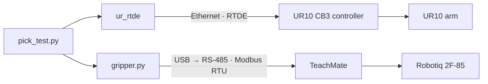

# auto-UR10

Integrating an autonomous software system for a **Universal Robots UR10** collaborative arm.

This project brings a second-hand UR10 cell back into service and controls it from Python: the arm over Ethernet with RTDE, and a Robotiq 2F-85 gripper over RS-485 (Modbus RTU), both coordinated from a single script.

## Hardware

| Component | Details |
|---|---|
| Robot arm | Universal Robots UR10, CB3 controller, PolyScope 3.15.6 |
| Base | Ready Robotics TaskMate R10 mobile cart |
| Gripper | Robotiq 2F-85 (2-finger, electric) |
| Gripper interface | USB-to-RS-485 adapter, through the Ready Robotics TeachMate |
| Camera | Intel RealSense D455 |

## How it works



- The **UR10 controller** keeps real-time control and enforces the safety limits (safety planes and joint position limits).
- **`ur_rtde`** sends motion commands and reads the robot state.
- **`gripper.py`** drives the gripper directly with Modbus RTU frames, without a URCap.
- The cart's original Ready Robotics ForgeOS layer is not used; the robot runs on native PolyScope.

## Repository

| Path | Description |
|---|---|
| `README.md` | Project overview, hardware, architecture and quick usage. |
| `requirements.txt` | Python dependencies: `ur_rtde` and `pyserial`. |
| `.gitignore` | Ignores Python artifacts, editor/OS files, robot backups, PolyScope programs and installations, and logs. |
| `LICENSE` | MIT License. |
| `CLAUDE.md` | Guidance for Claude Code: project context, git rules, documentation and hardware-safety requirements. |
| [`scripts/`](scripts/) | Python control scripts. |
| [`scripts/gripper.py`](scripts/gripper.py) | Minimal Modbus RTU driver for the Robotiq 2F-85: status, activate, open, close. Usable from the command line or as a module. |
| [`scripts/pick_test.py`](scripts/pick_test.py) | Arm and gripper smoke test: activates the gripper, lifts the tool 2 cm, closes and opens the gripper, returns to the start pose. |
| [`scripts/show_pose.py`](scripts/show_pose.py) | Read-only position readout: prints the TCP pose (mm, rotation vector, roll/pitch/yaw) and joint angles, once or continuously with `--watch`. |
| [`docs/`](docs/) | Lab documentation. |
| [`docs/setup.md`](docs/setup.md) | Lab operating procedure: network and serial setup, safety checklist, start-up, shutdown, troubleshooting, Modbus reference. |
| [`docs/commissioning.md`](docs/commissioning.md) | Engineering write-up of how the cell was brought back into service, including the wrong turns. |

## Usage

Requirements: Python 3, `ur_rtde`, `pyserial`, and a computer on the robot's subnet (robot at `192.168.0.1`).

```bash
pip install ur_rtde pyserial

python gripper.py status      # check the gripper answers
python gripper.py activate    # after every power cycle; fingers open and close fully
python pick_test.py           # arm + gripper test
python show_pose.py --watch   # live TCP pose and joint angles (read-only)
```

Keep a hand on the emergency stop during any Python-commanded motion, and do not run a PolyScope program at the same time.

## Background

The UR10 and its cart were donated to the lab without documentation. The cart was built around Ready Robotics' ForgeOS, which became unsupported after the company shut down in 2024. Commissioning involved moving the cell to native PolyScope, setting up its safety configuration, clearing leftover fieldbus settings that blocked RTDE, and finding that the RS-485 adapter and wiring for the gripper were already inside the cart, so Python control required no new parts.

---

**Author:** [Gabriel-smm](https://github.com/Gabriel-smm)
