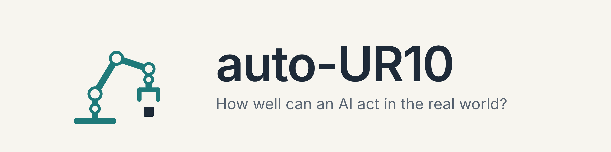
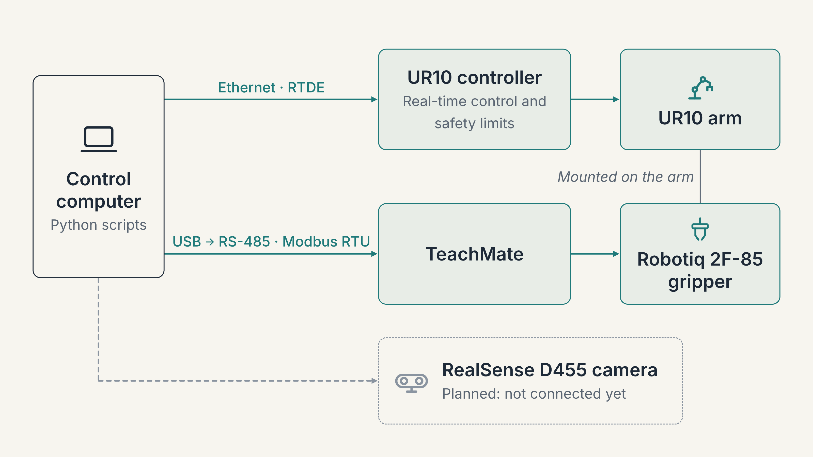
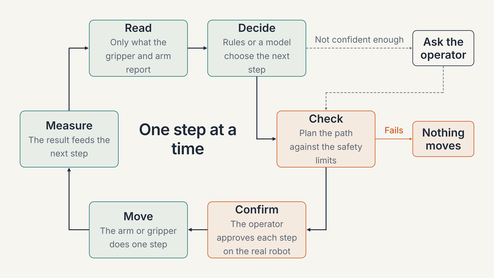
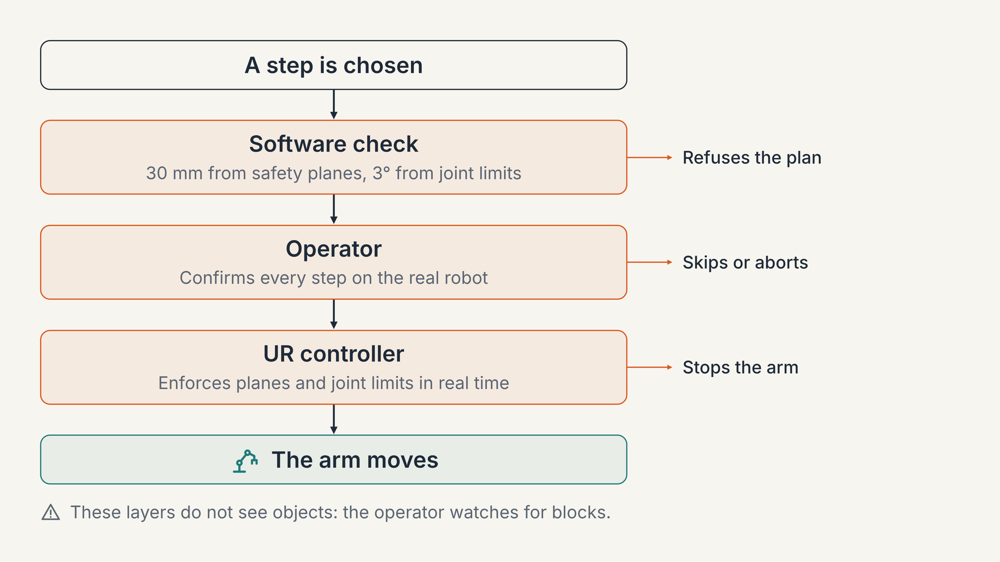
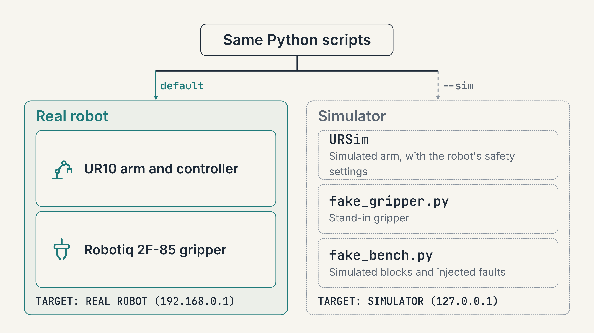

# auto-UR10

Building an autonomous software system for a second-hand **Universal Robots UR10** arm.

## What this is

A donated robot arm arrived in the lab with no documentation and with control software whose maker had shut down. This project brought it back into service and controls it from ordinary Python on one computer: the arm, its gripper, and the safety checks around them.

On top of that sits a decision loop: given an instruction like *"Move the block in A to C"*, a decider chooses the robot's next step, one at a time, from what the arm and gripper actually report. The goal is autonomous pick-and-place.

## Status

| Capability | State |
|---|---|
| Arm and gripper controlled from one script | **Working on the real robot** |
| Live position and safety-margin readouts | **Working on the real robot**, checked against the teach pendant |
| Decision loop with hand-written rules | **Simulation only.** Handles 42 of 63 test runs on the block-moving scenarios, with and without faults; the failures are faults it cannot recover from, like a dropped block. It understands only two fixed forms of instruction |
| Decision loop with an AI decision model (d3-lite) | **Not working yet.** With the current small-step options it repeats its first move. With the earlier `pick` and `place` options it completed a one-block move in the simulator, with an operator accepting its low-confidence steps |
| Decision loop on the real robot | **Not yet run** |
| Vision with the RealSense D455 | **Planned.** The camera is not used by any code yet |

## The cell



One computer talks to two devices over two separate links. The UR10's own controller keeps real-time control of the arm. The gripper needed no new parts: its adapter and wiring were already inside the cart.

| Component | Details |
|---|---|
| Robot arm | Universal Robots UR10, CB3 controller, PolyScope 3.15.6 |
| Base | Ready Robotics TaskMate R10 mobile cart |
| Gripper | Robotiq 2F-85 (2-finger, electric) |
| Camera | Intel RealSense D455 (planned) |

## How it decides



The decider sees only real readings, never the simulator's hidden truth about where the blocks are. It can be hand-written rules, or a decision model that gives a probability for each option. When the model is not confident enough, it abstains and the operator is asked. Every step is logged, so a run can be replayed and scored afterwards.

## How it stays safe



The software check refuses a move early, with a margin; the robot's controller enforces its limits whatever the software does. These layers know about walls and joint limits, not about objects, so on the real robot the operator watches for collisions with blocks, with a hand on the emergency stop.

## Try it without a robot



These two need only Python 3, and neither a robot nor a simulator:

```bash
pip install -r requirements.txt

python -m pytest tests -q     # offline tests
python scripts/run_task.py --sim --backend fake --scenario scenarios/nominal.json --mode headless
```

The second one runs a full episode with simulated blocks and prints `success`. To watch the arm move in the simulator (needs Docker), follow [Simulation (URSim)](docs/setup.md#simulation-ursim).

## Run it on the robot

Read the [safety checklist and start-up procedure](docs/setup.md#pre-session-safety-checklist) first. Keep a hand on the emergency stop during any Python-commanded motion, and do not run a PolyScope program at the same time.

```bash
python scripts/gripper.py status      # check the gripper answers
python scripts/safety.py watch        # live distance to the safety limits (read-only)
python scripts/gripper.py activate    # after every power cycle; the fingers move fully
python scripts/pick_test.py           # arm + gripper test; the tool lifts 2 cm
```

Every robot script prints `TARGET: REAL ROBOT (192.168.0.1)` or `TARGET: SIMULATOR (127.0.0.1)` before connecting. Check it before every motion run.

## Documentation

| Document | Read it when you want |
|---|---|
| [`docs/setup.md`](docs/setup.md) | To run the cell: network and serial setup, safety checklist, every script, troubleshooting, Modbus reference. |
| [`docs/architecture.md`](docs/architecture.md) | To change the code: technical flowcharts and what every file does. |
| [`docs/commissioning.md`](docs/commissioning.md) | The story of how the cell came back into service, wrong turns included, and the lessons. |

## Background

The UR10 and its cart were donated to the lab without documentation. The cart was built around Ready Robotics' ForgeOS, which became unsupported after the company shut down in 2024. Commissioning moved the cell to the robot's native PolyScope software and set up its safety configuration; no parts were bought. [Read the full story](docs/commissioning.md).

---

**Author:** [Gabriel-smm](https://github.com/Gabriel-smm)
