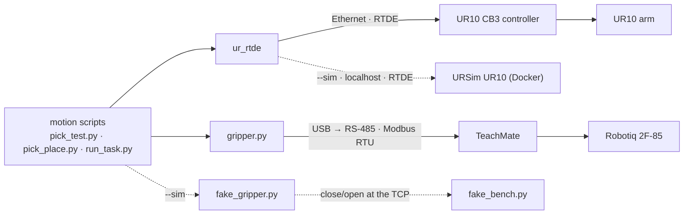
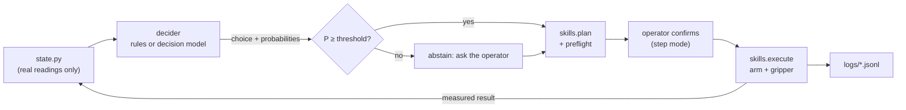
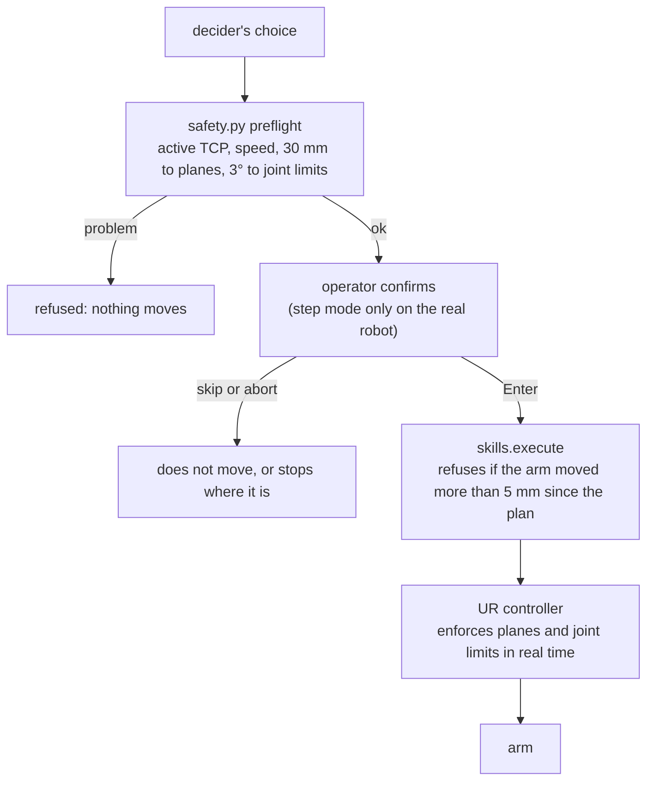
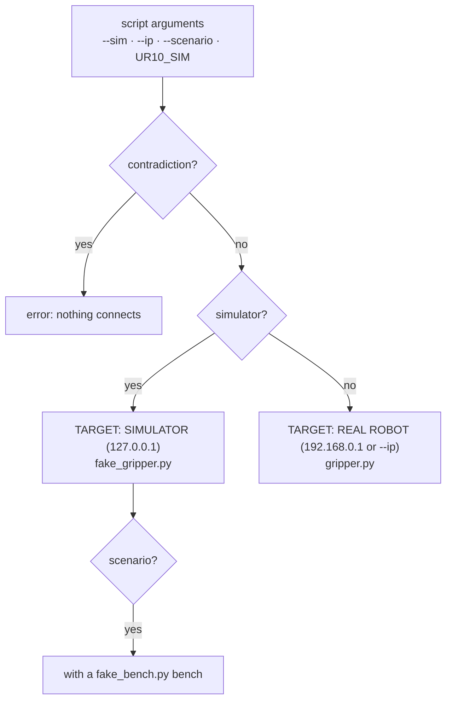

# Architecture

How the software fits together, and what every file in the repository does. For a plain overview, see the [README](../README.md). For how to run the cell, see [setup.md](setup.md). For how it came to be this way, see [commissioning.md](commissioning.md).

## Contents

- [System](#system)
- [Decision loop](#decision-loop)
- [Safety layers](#safety-layers)
- [Target selection](#target-selection)
- [Repository](#repository)

## System

- The **UR10 controller** keeps real-time control and enforces the safety limits (safety planes and joint position limits).
- **`safety.py`** holds a copy of those limits. The motion scripts check every planned path against it, with a margin, before moving; see [Safety configuration](setup.md#safety-configuration).
- **`ur_rtde`** sends motion commands and reads the robot state.
- **`gripper.py`** drives the gripper directly with Modbus RTU frames, without a URCap.
- The cart's original Ready Robotics ForgeOS layer is not used; the robot runs on native PolyScope.
- **URSim**, Universal Robots' simulator, runs as a simulated UR10 in Docker on the control computer, with the robot's installation loaded, so `ur_rtde` scripts can be tried on `127.0.0.1` before the real arm. With `--sim`, **`robot.py`** points the scripts at it and swaps in **`fake_gripper.py`** for the gripper; see [Simulation (URSim)](setup.md#simulation-ursim).
- The **RealSense D455** is part of the cell but is not used by any code yet.

## Decision loop

One episode of [`run_task.py`](../scripts/run_task.py). The decider chooses one primitive per step (`move:X`, `down`, `up`, `open`, `close`, `home`) or `done`.

- **The decider** is hand-written rules ([`decision_rules.py`](../scripts/decision_rules.py)) or a vllm-sr decision model, by default `vllm-sr/d3-lite` ([`decision_model.py`](../scripts/decision_model.py)). It sees the state built by [`state.py`](../scripts/state.py) from gripper and arm readings, never the bench's true contents; the model sees a shorter `view` of it.
- **Abstaining** behaves by mode: in step mode the operator is asked; in `auto` and `headless`, which are simulator-only, the episode ends as `abstained`.
- **Every skill** is planned and checked against the safety configuration before it moves. On the real robot, only step mode is accepted, so the operator confirms every skill.

Details: [`run_task.py`](setup.md#scriptsrun_taskpy), [`skills.py`](setup.md#scriptsskillspy), [`state.py`](setup.md#scriptsstatepy).

## Safety layers

What stands between a decider's choice and the arm moving, on the real robot.

The controller enforces its limits whatever the software does; the software checks only refuse a move earlier, with a margin.

These layers do not model objects. Nothing stops a `down` with the gripper closed into a slot that holds a block, so on the real robot the operator's confirmation is the only guard against pushing into a block; see the note under [`skills.py`](setup.md#scriptsskillspy).

## Target selection

How [`robot.py`](../scripts/robot.py) chooses what a script talks to. The full rules, including the combinations it rejects, are under [`robot.py`](setup.md#scriptsrobotpy).

## Repository

| Path | Description |
|---|---|
| [`README.md`](../README.md) | Project overview for readers new to the project: what it is, its status, diagrams and a quick start. |
| `requirements.txt` | Python dependencies: `ur_rtde`, `pyserial`, `rich` for the decision panel, and `pytest` for the offline tests. |
| `.gitignore` | Ignores Python artifacts, editor/OS files, robot backups, PolyScope programs, installations and variables files, and logs. |
| `LICENSE` | MIT License. |
| `CLAUDE.md` | Guidance for Claude Code: project context, git rules, documentation and hardware-safety requirements. |
| [`scripts/`](../scripts/) | Python control scripts. |
| [`scripts/gripper.py`](../scripts/gripper.py) | Minimal Modbus RTU driver for the Robotiq 2F-85: status, activate, open, close. Usable from the command line or as a module. |
| [`scripts/pick_test.py`](../scripts/pick_test.py) | Arm and gripper smoke test: activates the gripper, lifts the tool 2 cm, closes and opens the gripper, returns to the start pose. |
| [`scripts/show_pose.py`](../scripts/show_pose.py) | Read-only position readout: prints the TCP pose (mm, rotation vector, roll/pitch/yaw) and joint angles, once or continuously with `--watch`. |
| [`scripts/pick_place.py`](../scripts/pick_place.py) | Moves from the current position to a fixed target pose, closes the gripper, and returns to the start. |
| [`scripts/safety.py`](../scripts/safety.py) | The robot's safety configuration (planes, joint limits, TCP, payload) as constants, with path checks for the motion scripts, a live read-only margin display (`watch`), and a check of an exported `.installation` (`compare`). |
| [`scripts/robot.py`](../scripts/robot.py) | Target selection shared by the robot scripts: `--sim`, `--ip` and `UR10_SIM=1`, the `TARGET:` banner, rejection of contradictions, and the choice of `gripper` or `fake_gripper`. |
| [`scripts/fake_gripper.py`](../scripts/fake_gripper.py) | Stand-in for `gripper.py` for simulator runs: same functions and status keys, state in memory, close result set by a scenario (`wide`, `narrow`, none). Opens no port. |
| [`scripts/fake_bench.py`](../scripts/fake_bench.py) | Simulated bench for simulator runs: named slots with grip poses and blocks, what the gripper reports on a close or open at the TCP position, and seeded fault injection (slip, miss, width noise, ghost block) logged as JSON lines. |
| [`scripts/slots.json`](../scripts/slots.json) | Taught TCP poses of the bench slots `A`, `B`, `C`, `bin` and `home` (base frame, m and rotation vector), and `approach_z`, the height above a slot from which the skills descend. |
| [`scripts/skills.py`](../scripts/skills.py) | Skills for the decision loop: the primitives a decider chooses (`move:X` to above a slot or the bin, `down`, `up`, `open`, `close`, `home`), and `pick`/`place` built from them. Each is planned, checked segment by segment before moving, and returns measured gripper readings. |
| [`scripts/fake_arm.py`](../scripts/fake_arm.py) | In-memory stand-in for the RTDE control and receive interfaces, for offline tests and `--backend fake`. |
| [`scripts/state.py`](../scripts/state.py) | Builds the decider's state from real readings only (gripper, TCP slot, per-slot counts, last 5 skill results) and the valid options. |
| [`scripts/decision.py`](../scripts/decision.py) | The `Decision` every decider returns, the plain-language option descriptions, and the goal-to-primitive steps shared by the rules decider and `summarize.py`. |
| [`scripts/decision_rules.py`](../scripts/decision_rules.py) | Hand-written baseline decider: a state machine over the full state. |
| [`scripts/decision_model.py`](../scripts/decision_model.py) | Decider backed by a vllm-sr decision model (default `vllm-sr/d3-lite`, which fits the 4 GB GPU): one `system_one` call per step with `next_skill`, `last_ok` and `task_done`, over `view(state)`: what is known about each slot, without the action history. |
| `requirements-model.txt` | Extra dependencies for the model decider: `torch`, `transformers>=5.17`, `accelerate`, `safetensors`, and `pillow`, `torchvision`, `opencv-python-headless` (imported by d3). |
| `pytest.ini` | Registers the `model` test marker and leaves those tests out of the default run. |
| [`scripts/run_task.py`](../scripts/run_task.py) | Runs one decision episode with a terminal panel: state, option probabilities, plan and preflight before moving, result, and (simulator) the bench truth. Step mode confirms every skill; auto and headless are simulator-only. Logs every step to `logs/*.jsonl`. |
| [`scripts/panel.py`](../scripts/panel.py) | The `rich` panels shared by `run_task.py` and `replay.py`. |
| [`scripts/replay.py`](../scripts/replay.py) | Replays a logged episode in the same panels, step by step, without a robot. |
| [`scripts/run_suite.py`](../scripts/run_suite.py) | Runs every scenario under several seeds, headless in the simulator (fake backend by default), and writes a suite file. |
| [`scripts/summarize.py`](../scripts/summarize.py) | Per decider/model: success rate, step accuracy against the bench truth, abstentions right and wrong, reaction to each injected fault, steps, latency and VRAM. |
| [`scripts/grip_width.py`](../scripts/grip_width.py) | Block width <-> 2F-85 finger position, interpolated between calibration points (one measured: 73 mm at pos 67). |
| [`scripts/ursim.sh`](../scripts/ursim.sh) | Starts URSim (CB3, PolyScope 3.15.8) as a UR10 in Docker: image pinned by digest, ports on localhost, programs folder `~/ursim/programs`. |
| [`scenarios/`](../scenarios/) | Bench scenarios for `fake_bench.py` (JSON): blocks per slot, seed and faults, from nominal runs to slips, misses and ghost blocks. |
| [`tests/`](../tests/) | Offline `pytest` tests for the simulation stand-ins; no robot, URSim or gripper needed. |
| [`docs/`](.) | Technical documentation. |
| [`docs/architecture.md`](architecture.md) | This file: flowcharts of the system and the repository map. |
| [`docs/setup.md`](setup.md) | Lab operating procedure and script reference: network and serial setup, safety checklist, start-up, shutdown, troubleshooting, Modbus reference. |
| [`docs/commissioning.md`](commissioning.md) | Engineering write-up of how the cell was brought back into service, including the wrong turns. |
| [`docs/images/`](images/) | The README's images, and [`PROMPTS.md`](images/PROMPTS.md), the prompts that generate them. |
